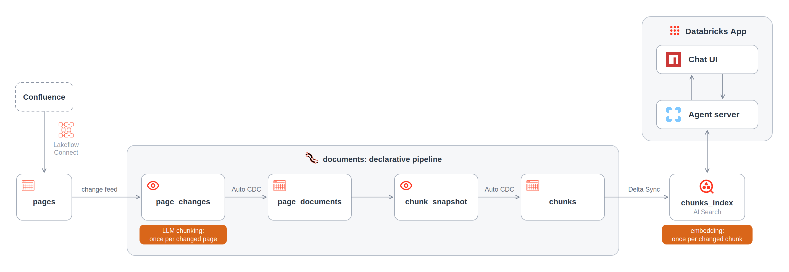
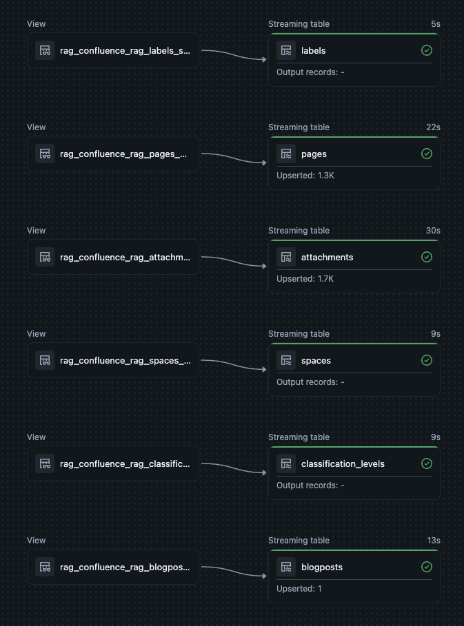
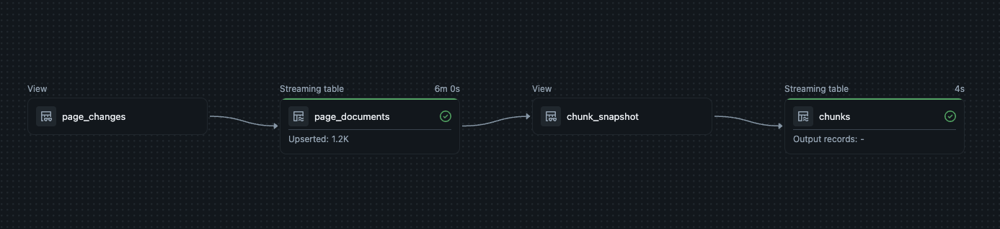
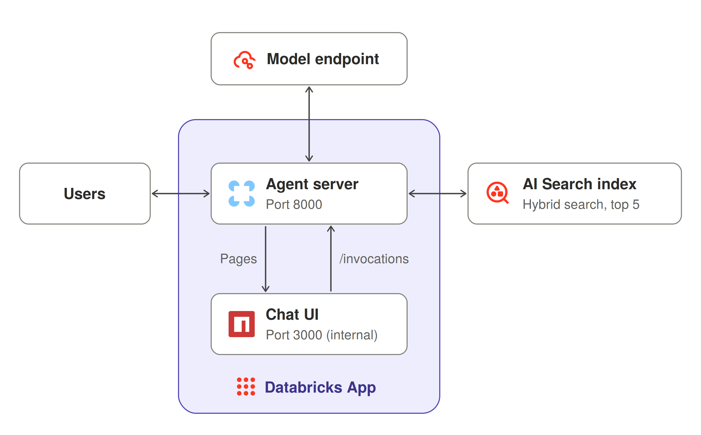

# A minimal Confluence RAG on Databricks

I wanted to show what a minimal RAG looks like when built from native Databricks parts. It had to be a tool that is useful right away, yet simple to understand. So I built a chat app that answers questions from your company's Confluence wiki. The main design goal for this project is low cost. A naive RAG implementation re-chunks and re-embeds the whole wiki on every refresh, so there is a daily cost that grows with the size of the wiki. In this design, the pipeline streams and processes only the changes so that the cost stays minimal. On a test wiki, a daily update is more than 90% cheaper than a full refresh (see step 4).

The app consists of a managed Lakeflow connector to ingest the data, a serverless declarative pipeline that chunks the pages with [`ai_prep_search`](https://docs.databricks.com/aws/en/sql/language-manual/functions/ai_prep_search), an AI Search index to embed the chunks, and a LangChain agent behind Databricks' chat UI template. The whole thing is shipped as a single Databricks App.



I created a [repository](https://github.com/revodatanl/experimental-native-db-rag) with five commits. Each commit corresponds to a step that is described below. It is a [Declarative Automation Bundle](https://docs.databricks.com/aws/en/dev-tools/bundles/) of about 300 lines of code. Clone it, follow the README, and you have a working RAG application.

Follow along in the text below to watch the app take shape.

> A sixth commit pins three dependencies. `certifi` and `uv` move to releases whose trust bundles drop the eMudhra/emSign certificate authorities, which were revoked for key compromise in October 2026. `pandas` is pinned below 3, because pandas 3.1 breaks `pyspark.pandas` on Databricks Runtime 18.

## Step 1: the project scaffolding

The first commit is the result of `uv init` plus `databricks.yml`, the heart of the bundle. It names the bundle, includes `resources`, and sets variables. The `dev` target uses development mode, which prefixes every resource with the deploying user's name, so two people can work in the same workspace without colliding. The workspace host is omitted on purpose, and comes from the CLI profile.

## Step 2: ingest with the managed connector

[Lakeflow Connect](https://docs.databricks.com/aws/en/ingestion/lakeflow-connect/) is Databricks' set of managed connectors for SaaS applications such as Salesforce and Jira, and for databases such as SQL Server. Confluence is also [supported](https://docs.databricks.com/aws/en/ingestion/lakeflow-connect/confluence), but only Confluence Cloud. The connector runs as a serverless [Lakeflow Spark Declarative Pipeline](https://docs.databricks.com/aws/en/ldp/).

The pipeline reaches Confluence through a [connection](https://docs.databricks.com/aws/en/connect/uc-connections): a Unity Catalog object that holds the credentials, created once in Catalog Explorer. Conveniently, a connection belongs to the metastore, not to one workspace, so `dev` and `prod` workspaces attached to the same metastore can use the same connection. That is also why creating one requires the `CREATE CONNECTION` privilege on the metastore, which usually means an admin.

Once the connection exists, declare the pipeline in the bundle, so that every target environment gets the same one:

```yaml
resources:
  schemas:
    rag:
      catalog_name: ${var.catalog}
      name: ${var.schema}
      comment: Raw Confluence tables and everything derived from them.

  pipelines:
    ingest:
      name: ${bundle.name}-ingest
      catalog: ${var.catalog}
      schema: ${resources.schemas.rag.name}
      ingestion_definition:
        connection_name: ${var.confluence_connection}
        source_type: CONFLUENCE
        objects:
          - schema:
              source_schema: default
              destination_catalog: ${var.catalog}
              destination_schema: ${resources.schemas.rag.name}
```

`connection_name` names the connection, and `source_type: CONFLUENCE` selects the connector. The pipeline's own `catalog` and `schema` are where it publishes.

`objects` says what to copy and where. The `source_schema` key describes the Confluence side. The connector exposes all its tables under one fixed source schema named `default` (which has nothing to do with Unity Catalog's `default` schema). The data lands in `destination_schema`. Because the object is a whole `schema` rather than a `table`, the pipeline takes every table the connector offers and picks up new ones when Databricks adds them.

The connector loads pages, blog posts, spaces, labels, classification levels and attachments. Page bodies arrive in Confluence storage format, which is XHTML. Attachments arrive as metadata and a download link, not as files (more on that in step 3).



After the first load, a run writes only the pages that changed, so ingestion is incremental. The connector records every insert, update and delete on `pages` in the table's [change data feed](https://docs.databricks.com/aws/en/tables/features/change-data-feed), a Delta feature that logs row-level changes between table versions. From step 3 on, the project reads that feed, so only changed pages get converted, chunked and embedded.

## Step 3: pages to chunks

The second pipeline, `documents`, turns the connector's pages into chunks that the index can embed. It converts each page from XHTML to Markdown, chunks the Markdown with `ai_prep_search`, and keeps one row per chunk. It reads the change feed from step 2, so a run converts and chunks only the pages that changed.



> The graph seemingly shows no output records for `chunks`, which is a problem of the UI: the run delivered 2,276 chunks from 1,226 pages.

### From XHTML to Markdown

```python
from markdownify import markdownify
from pyspark.sql.functions import udf


@udf("string")
def to_markdown(xhtml: str | None) -> str:
    return markdownify(xhtml or "", heading_style="ATX").strip()
```

`to_markdown` is a Python UDF: Spark calls it once per row, and `markdownify` returns Markdown with `#` headings. Pages that hold only images come out empty, and the pipeline leaves them out.

For example, take this page from the test wiki: [Recommended MLOps workflow by Databricks](https://docs.databricks.com/aws/en/machine-learning/mlops/mlops-workflow). Its body in storage format:

```html
<h3><strong>Recommended MLOps workflow by Databricks</strong></h3>
<h4><strong>Development stage</strong></h4>
<ul><li><p>Data integration</p></li><li><p>EDA</p></li><li><p>Code in repos</p></li><li><p>Creating and updating feature tables</p></li><li><p>Model training</p></li></ul>
<ac:image ac:align="center" ac:layout="center" ac:original-height="600" ac:original-width="772"><ri:attachment ri:filename="image-20230123-123144.png" ri:version-at-save="1" /></ac:image>
<h4><strong>Staging stage</strong></h4>
...
```

And this is the same part after `to_markdown`:

```markdown
### **Recommended MLOps workflow by Databricks**

#### **Development stage**

* Data integration
* EDA
* Code in repos
* Creating and updating feature tables
* Model training

#### **Staging stage**
...
```

**Note that images are missing from the documents.** Confluence stores every image as an attachment that are not ingested, which is a [known limitation](https://docs.databricks.com/aws/en/ingestion/lakeflow-connect/confluence-limits#content-ingestion) of the connector. Reading them takes an API token in a secret scope, a download step, a vision model through [`ai_query`](https://docs.databricks.com/aws/en/sql/language-manual/functions/ai_query), and [`ai_parse_document`](https://docs.databricks.com/aws/en/sql/language-manual/functions/ai_parse_document) for PDFs. I will cover this in a follow-up article.

### Chunking with `ai_prep_search`

[`ai_prep_search`](https://docs.databricks.com/aws/en/sql/language-manual/functions/ai_prep_search) is a SQL function that takes a document and returns search-ready chunks. It accepts plain text or Markdown. It splits a document into semantic chunks and returns two texts per chunk. `chunk_to_retrieve` is the raw chunk text, which the language model reads. `chunk_to_embed` is the same text with added context, which the index embeds. For a Markdown page, that context is a few document fields that an LLM picks per document, such as "Company" or "Document Type", and one LLM-written sentence on what the document is about.

Take for instance the MLOps page from the previous section. Its `chunk_to_retrieve` is the unchanged Markdown above. Its `chunk_to_embed` puts three fields and one sentence in front of it:

```text
Category: MLOps
Company: Databricks
Subject: Recommended MLOps workflow

Databricks created a recommended MLOps workflow guide.

Content:

### **Recommended MLOps workflow by Databricks**

#### **Development stage**

* Data integration
...
```

An LLM chose the field names `Category`, `Company` and `Subject` for this page.

The function is in Beta and needs Databricks Runtime 18.2 or above, so the documents pipeline runs on the `PREVIEW` channel. There is no chunk size or overlap setting, and there is no Python binding, so the pipeline calls it through `F.expr`.

Some typical alternatives are fixed-size chunks with overlap, recursive splitting on separators, or semantic chunking that splits where the meaning changes. `ai_prep_search` does semantic chunking and adds the context in one call. The trade-offs: you can't control the chunk size, and the output is non-deterministic, since an LLM writes part of `chunk_to_embed` on every call.

### Streaming changes

The pipeline stores the processed pages in a table called `page_documents`. A materialized view, a table kept equal to the result of a query, might seem like the obvious choice. But Databricks can only [refresh it incrementally](https://docs.databricks.com/aws/en/ldp/incremental-refresh) when the query uses deterministic functions, and `ai_prep_search` is not one, so every refresh would re-chunk the entire wiki. A streaming table, which processes each new input row once, avoids that. Its input is the change data feed from step 2, which turns every insert, update and delete on `pages` into a stream of events.

```python
from pyspark import pipelines as dp
from pyspark.sql import functions as F


@dp.temporary_view()
def page_changes() -> DataFrame:
    current = F.expr("_change_type != 'delete' AND status = 'current' AND isDeleted IS NOT TRUE")
    markdown = F.nullif(to_markdown("body.storage.value"), F.lit(""))
    return (
        spark.readStream.option("readChangeFeed", "true")
        .table(f"{catalog}.{schema}.pages")
        .where("_change_type != 'update_preimage'")
        .select(
            "id",
            "title",
            F.col("web_url").alias("path"),
            F.when(current, markdown).alias("content"),
            "_commit_version",
        )
        .withColumn("chunks", F.variant_get(F.expr("ai_prep_search(content)"), "$.document.contents", CHUNKS))
    )


dp.create_streaming_table("page_documents", comment="Current pages as Markdown, with their chunks.")
dp.create_auto_cdc_flow(
    target="page_documents",
    source="page_changes",
    keys=["id"],
    sequence_by="_commit_version",
    apply_as_deletes="content IS NULL",
    except_column_list=["_commit_version"],
)
```

`page_changes` is a temporary view that reads the change feed of `pages`. Every change arrives with a `_change_type` and a `_commit_version`. Updates emit both a "before" and an "after" row, so the view drops the "before" rows (`update_preimage`), converts the remaining pages to Markdown and chunks them. `CHUNKS` defines the schema of the chunk array. If a page is deleted, archived or empty, its `content` is set to `NULL`. The call to `ai_prep_search` sits in this view, upstream of Auto CDC, so it runs once per changed page.

[Auto CDC](https://docs.databricks.com/aws/en/ldp/cdc) applies the change stream to `page_documents` automatically. It matches rows by `id`, orders changes using `_commit_version`, deletes any page from the target where `content IS NULL`, and drops the `_commit_version` column from the final table.

### Flattening the chunks

Because the index requires one row per chunk, the pipeline creates a `chunks` table and keeps it in sync with a second Auto CDC flow, this time [from a snapshot](https://docs.databricks.com/aws/en/ldp/developer/ldp-python-ref-apply-changes-from-snapshot):

```python
@dp.temporary_view()
def chunk_snapshot() -> DataFrame:
    return (
        spark.read.table("page_documents")
        .select("id", "path", F.explode("chunks").alias("chunk"))
        .select(
            F.concat_ws("-", "id", "chunk.chunk_position").alias("chunk_id"),
            "path",
            "chunk.chunk_to_embed",
            "chunk.chunk_to_retrieve",
        )
    )


dp.create_streaming_table(
    "chunks",
    comment="One row per chunk, the vector index's source.",
    table_properties={"delta.enableChangeDataFeed": "true"},
)
dp.create_auto_cdc_from_snapshot_flow(target="chunks", source="chunk_snapshot", keys=["chunk_id"])
```

The temporary view flattens the `chunks` array from `page_documents` so each chunk gets its own row. It builds a `chunk_id` by combining the page `id` and `chunk_position`. On each run the snapshot flow compares `chunk_snapshot` with `chunks`: it inserts new chunks, updates changed ones, deletes missing ones and leaves the rest alone. The change data feed is on for `chunks`, so the index sees only the rows that changed.

## Step 4: index the chunks

The next step adds the AI Search endpoint, the index itself, and a job that runs ingestion, document processing, and index syncing in sequence.

### The AI Search endpoint

[Databricks AI Search](https://docs.databricks.com/aws/en/ai-search/ai-search) (f.k.a. Vector Search) is Databricks' managed vector database. Note that the code and the APIs still use the old name (`vector_search_endpoints`, `vector_search_indexes`).

```yaml
resources:
  vector_search_endpoints:
    vs:
      name: confluence-rag
      endpoint_type: STANDARD
```

The first deploy takes a few minutes while the endpoint comes online.

### The index

`chunks_index` is a triggered Delta Sync index backed by the `chunks` table. It uses `chunk_id` as the primary key and embeds the `chunk_to_embed` column. The bundle declares the endpoint but not the index: an index needs its source table, and `chunks` only exists after the documents pipeline has run once. So the notebook `index.py` creates the index on the first run and syncs it on every run after that:

```python
from databricks.sdk import WorkspaceClient
from databricks.sdk.errors import ResourceAlreadyExists
from databricks.sdk.service.vectorsearch import (
    DeltaSyncVectorIndexSpecRequest,
    EmbeddingSourceColumn,
    PipelineType,
    VectorIndexType,
)

w = WorkspaceClient()
try:
    w.vector_search_indexes.create_index(
        name=index_name,
        endpoint_name=endpoint,
        primary_key="chunk_id",
        index_type=VectorIndexType.DELTA_SYNC,
        delta_sync_index_spec=DeltaSyncVectorIndexSpecRequest(
            source_table=chunks_table,
            pipeline_type=PipelineType.TRIGGERED,
            embedding_source_columns=[
                EmbeddingSourceColumn(name="chunk_to_embed", embedding_model_endpoint_name="databricks-qwen3-embedding-0-6b")
            ],
        ),
    )
except ResourceAlreadyExists:
    w.vector_search_indexes.sync_index(index_name=index_name)
```

Embeddings are generated automatically by the `databricks-qwen3-embedding-0-6b` endpoint, the model Databricks [recommends](https://docs.databricks.com/aws/en/ai-search/create-ai-search) for standard endpoints like this one. The model [handles up to about 32K tokens](https://docs.databricks.com/aws/en/machine-learning/foundation-model-apis/supported-models), which leaves plenty of room for the context that `ai_prep_search` adds to each chunk.

Databricks also registers this model in [Unity Gateway](https://docs.databricks.com/aws/en/unity-gateway/), its layer for governed access to models, as the model service `system.ai.qwen3-embedding-0-6b`. The index can't use that name: `embedding_model_endpoint_name` only accepts serving endpoints, and the model service name fails with "Model Serving endpoint system.ai.qwen3-embedding-0-6b was not found". The app in step 5 does go through Unity Gateway.

> The `databricks-qwen3-embedding-0-6b` endpoint is in Public Preview. If your workspace doesn't have it, use `databricks-gte-large-en` instead. With an 8,192-token window, it is a good alternative for an English wiki. It handles English only, while Qwen3 supports over 100 languages, so keep Qwen3 for a multilingual wiki.

### The refresh job

Three tasks in order: `ingest` runs the connector, `documents` runs the pipeline, `index` creates or syncs the index.

```yaml
  jobs:
    refresh:
      name: ${bundle.name}-refresh
      tasks:
        - task_key: ingest
          pipeline_task:
            pipeline_id: ${resources.pipelines.ingest.id}

        - task_key: documents
          depends_on:
            - task_key: ingest
          pipeline_task:
            pipeline_id: ${resources.pipelines.documents.id}

        - task_key: index
          depends_on:
            - task_key: documents
          notebook_task:
            notebook_path: ../src/index.py
            base_parameters:
              catalog: ${var.catalog}
              schema: ${resources.schemas.rag.name}
              vector_search_endpoint: ${resources.vector_search_endpoints.vs.name}

      schedule:
        quartz_cron_expression: "0 0 1 * * ?"
        timezone_id: Europe/Amsterdam
        pause_status: PAUSED
```

The nightly schedule ships paused. Unpause it when the index should stay current.

### Deletions

No code in the project handles deletes, yet a page that leaves the wiki also leaves the index:

1. Someone deletes or archives a page in Confluence.
2. The connector records that in `pages`, and the change feed gets a row for it.
3. `page_changes` gives that page `content = NULL`.
4. The Auto CDC flow removes the page from `page_documents`.
5. The page's chunks are no longer in `chunk_snapshot`, so the snapshot flow deletes them from `chunks`.
6. The change data feed of `chunks` records those deletes, and the next index sync removes them from the index.

### Costs

The following numbers come from a test wiki of 1,226 pages with text, which resulted in 2,276 chunks. A full refresh processes everything; a daily update processes only what changed. The daily figures are averages of three incremental runs, in which less than 10 pages changed per run on average. All costs are in euros, at about €0.40 per DBU for pipelines and jobs and about €0.06 per DBU for embedding. Ingest costs nothing, because every workspace gets [100 free DBUs a day](https://www.databricks.com/blog/accelerate-business-insights-lakeflow-connect-now-free-tier) for managed connectors.

| Part | Full refresh (DBU) | Full refresh (€) | Daily update (DBU) | Daily update (€) |
| --- | ---: | ---: | ---: | ---: |
| Ingest | 0.18 | 0.00 | 0.10 | 0.00 |
| Documents parsing and chunking | 1.15 | 0.46 | 0.16 | 0.07 |
| Indexing | 3.98 | 1.60 | 0.31 | 0.13 |
| Embedding with `databricks-qwen3-embedding-0-6b` | 7.12 | 0.44 | under 0.001 | 0.00 |
| Total | | 2.51 | | 0.19 |

In the table, the index sync is the largest part of a full refresh. A daily update touches only what changed, so chunking drops from 1.15 to 0.16 DBU and embedding to almost nothing. What remains is mostly the fixed start-up cost of the index sync. Across the three incremental runs, a daily update is over 90% cheaper than a full refresh.

> **The AI Search endpoint is an always-on cost.** The table shows what a refresh costs, not what it costs to keep the app available. The endpoint bills by the hour as soon as it holds an index, whether or not anyone queries it. A Standard endpoint uses [4 DBU per hour](https://www.databricks.com/product/pricing/ai-search), which at about €0.06 per DBU is roughly €5.80 a day. The app also bills while it runs, and costs nothing while it is stopped. Unfortunately, Databricks Apps do not scale to zero.

Note that these are text-only numbers. Processing images costs far more, so streaming becomes even more important, but this is a topic for the follow-up article.

### Querying the index from SQL

Once the first job run has finished, the index can be tested without any app. The [`vector_search`](https://docs.databricks.com/aws/en/sql/language-manual/functions/vector_search) function queries an AI Search index in the SQL editor:

```sql
SELECT path, chunk_to_retrieve
FROM vector_search(
  index => 'main.confluence_rag.chunks_index',
  query_text => 'What are the stages of the MLOps workflow?',
  query_type => 'HYBRID',
  num_results => 5
)
```

Replace `main.confluence_rag` with your catalog and schema. The query runs the same hybrid search as the app's search tool in step 5 and returns the five best chunks. That makes it a powerful quick check of whether a question finds the right pages. When the app gives a poor answer, the same query indicates whether retrieval or the model is at fault. The function is in Public Preview.

## Step 5: the agent and the app

With the chunks indexed, the last step builds the chat app: an agent that searches the index and answers from what it finds. It consists of three components:

- The agent is built with LangChain's [`create_agent`](https://docs.langchain.com/oss/python/langchain/agents), which runs on [LangGraph](https://docs.langchain.com/oss/python/langgraph/overview). The agent it returns is a loop around a language model, which calls tools until it has enough to answer.
- The [MLflow agent server](https://mlflow.org/docs/latest/genai/serving/agent-server/) exposes the agent over HTTP in the [OpenAI Responses API](https://developers.openai.com/api/reference/resources/responses) format. Its code comes from Databricks' [agent template](https://github.com/databricks/app-templates/tree/main/agent-langgraph).
- Databricks' [chat UI template](https://github.com/databricks/app-templates/tree/main/e2e-chatbot-app-next) is the front end for that format.

[Databricks Apps](https://docs.databricks.com/aws/en/dev-tools/databricks-apps/) hosts all three together. It is the platform's way to run a web app next to the data, with its own identity.

The app is one package, `confluence_rag`, with two modules.

### `agent.py`

```python
from databricks.sdk import WorkspaceClient
from databricks_langchain import ChatDatabricks
from langchain.agents import create_agent
from langchain.tools import tool

mlflow.langchain.autolog()

w = WorkspaceClient()


@tool
def search_wiki(query: str) -> list[dict]:
    """Search the company wiki for passages relevant to a query."""
    response = w.vector_search_indexes.query_index(
        index_name=os.environ["VECTOR_SEARCH_INDEX"],
        columns=["chunk_to_retrieve", "path"],
        query_text=query,
        query_type="HYBRID",
        num_results=5,
    )
    rows = response.result.data_array if response.result else None
    return [{"text": text, "path": path} for text, path, _score in rows or []]


agent = create_agent(
    model=ChatDatabricks(model=os.environ["LLM_MODEL"], use_ai_gateway=True),
    tools=[search_wiki],
    system_prompt=SYSTEM_PROMPT,
)
```

`mlflow.langchain.autolog()` traces every call to the MLflow experiment the bundle creates.

The model reads the tool's docstring to decide when to search, and writes its own query. With `HYBRID`, the index does a [hybrid search](https://docs.databricks.com/aws/en/ai-search/query-ai-search), by meaning and by exact words at once, so it catches pages that paraphrase the question as well as pages that repeat its terms. It returns the five best chunks. The system prompt instructs the model to search before every answer, and to repeat the search when the results look thin. It should answer only from the results, cite the pages it used, and say so when the wiki has no answer. The two environment variables are set in `app.yml`. `LLM_MODEL` holds `system.ai.claude-sonnet-4-6`, the Unity Gateway model service for Claude Sonnet 4.6, and `use_ai_gateway=True` sends the model calls through Unity Gateway. `app.yml` declares the model service as an app resource:

```yaml
        - name: llm
          uc_securable:
            securable_full_name: system.ai.claude-sonnet-4-6
            securable_type: MODEL_SERVICE
            permission: EXECUTE
```

This grants the app's service principal `EXECUTE` on the model service, so access to the model is a Unity Catalog grant like any other. Every call also shows up in the `system.ai_gateway.usage` system table.

> Databricks CLI 1.19 warns that `MODEL_SERVICE` is an invalid value for `securable_type`. The warning is harmless: the deploy goes through and the app gets the model service.

The chat UI requires streamed responses, so the server registers a stream handler:

```python
from mlflow.genai.agent_server import AgentServer, stream
from mlflow.types.responses import (
    ResponsesAgentRequest,
    ResponsesAgentStreamEvent,
    output_to_responses_items_stream,
    to_chat_completions_input,
)


@stream()
async def stream_handler(request: ResponsesAgentRequest) -> AsyncGenerator[ResponsesAgentStreamEvent, None]:
    messages = to_chat_completions_input([item.model_dump() for item in request.input])
    async for step in agent.astream({"messages": messages}, stream_mode="updates"):
        for node in step.values():
            for event in output_to_responses_items_stream(node["messages"]):
                yield event


server = AgentServer("ResponsesAgent", enable_chat_proxy=True)
```

Here is how the stream works: `to_chat_completions_input` converts the incoming request into standard chat messages. Calling `agent.astream` with `stream_mode="updates"` emits an update each time a step finishes, a model call or a tool call, and `output_to_responses_items_stream` converts those messages into stream events. In the UI, the search query, its results, and the final answer appear one after another as each step completes. The last line creates the agent server.

### `app.py`

Databricks Apps starts the app with `uv run start-app`, which runs `main()` in `app.py`. On the first start it downloads the chat UI folder from Databricks' `app-templates` repository and builds it with `npm`; later starts reuse the build. Then the app starts the UI in the background and serves the agent.

Two servers run in one container, but Databricks Apps sends all traffic to port 8000. So the agent server listens there, and `enable_chat_proxy=True` makes it forward page requests to the chat UI on port 3000:



### Permissions

The app runs as its own service principal, which Databricks creates with the app. The bundle grants it `USE SCHEMA` and `SELECT` on the schema, which cover the index and anything added to the schema later. The exception is `USE CATALOG`, which the catalog owner has to grant. On `main`, all account users already have it, service principals included. On any other catalog, the owner gives a one-time grant (see the README).

In addition, `app.yml` grants `CAN_USE` to `account users`, so everyone in the organization can open the app with their Databricks single sign-on.

> **Be aware that everyone who can open the app can read every page in the index.** The connector ingests every page that the Confluence account behind the connection can reaad. The app searches as its own service principal, so there is no per-user access control. If that account can see restricted pages, so can the whole organization, so create the connection with a Confluence account that sees only what every app user may see.

## Conclusion

The result of this article is a working chat app over your company's wiki in about 300 lines, built from native Databricks parts. Because each change is processed only once, a daily update on the test wiki is more than 90% cheaper than a full refresh.

The app is minimal on purpose, and a real deployment probably needs more:

- **Images and attachments:** Databricks has the tools ([`ai_query`](https://docs.databricks.com/aws/en/sql/language-manual/functions/ai_query) with a vision model, and [`ai_parse_document`](https://docs.databricks.com/aws/en/sql/language-manual/functions/ai_parse_document)), but the connector ships no files.
- **Prompt management:** using the [MLflow Prompt Registry](https://docs.databricks.com/aws/en/mlflow3/genai/prompt-version-mgmt/prompt-registry) would version the system prompt.
- **Chat history:** the UI runs in ephemeral mode and keeps none. A [Lakebase instance](https://docs.databricks.com/aws/en/oltp/projects) is the perfect place to store it.
- **Evaluation:** nothing quantifies the quality of the answers yet.
- **Per-user access:** the app searches as its own service principal, so every user sees the whole index.

These omissions create opportunity for follow-up articles, and I will probably start by tackling images and attachments, and what they add to the cost. Potential other articles can take on the rest of the list.
